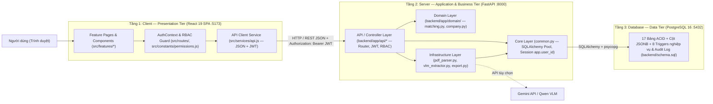

# Digital Invoice Management & Automated B2B Reconciliation

> **Hệ thống Quản lý Hóa đơn Điện tử & Đối soát 3 Chiều Tự động (`PO – GRN – Invoice`)**  
> Đề tài Công nghệ Phần mềm — Phân hệ Bên Mua (Accounts Payable / AP Automation)

---

## Mục lục

1. [Giới thiệu & Tính năng chính](#1-giới-thiệu--tính-năng-chính)
2. [Kiến trúc hệ thống: Client–Server (3-Tier) vs. MVC](#2-kiến-trúc-hệ-thống-clientserver-3-tier-vs-mvc)
3. [Công nghệ sử dụng (Tech Stack)](#3-công-nghệ-sử-dụng-tech-stack)
4. [Cấu trúc thư mục dự án chuẩn Công nghệ Phần mềm](#4-cấu-trúc-thư-mục-dự-án-chuẩn-công-nghệ-phần-mềm)
5. [Phân quyền (RBAC) & Tài khoản kiểm thử](#5-phân-quyền-rbac--tài-khoản-kiểm-thử)
6. [Hướng dẫn cài đặt & Khởi chạy chương trình](#6-hướng-dẫn-cài-đặt--khởi-chạy-chương-trình)
7. [Tổng quan RESTful API chính](#7-tổng-quan-restful-api-chính)
8. [Kiểm thử 3 cấp độ (Unit / Integration / E2E), Dữ liệu Demo & Bảo trì](#8-kiểm-thử-3-cấp-độ-unit--integration--e2e-dữ-liệu-demo--bảo-trì)

---

## 1. Giới thiệu & Tính năng chính

Hệ thống giúp doanh nghiệp bên mua số hóa và tự động hóa toàn bộ quy trình kiểm tra chứng từ đầu vào và thanh toán B2B:

- **Nhà cung cấp & Ánh xạ SKU (`nha_cung_cap`, `anh_xa_sku`):** Quản lý danh mục nhà cung cấp (tên, mã số thuế) và bảng quy đổi mã hàng nhà cung cấp sang mã SKU nội bộ.
- **Đơn đặt hàng (Purchase Order — `PO`):** Lập và theo dõi PO hàng hóa (`HANG_HOA`) hoặc dịch vụ (`DICH_VU`) qua popup chuyên biệt, tách rõ từng loại sản phẩm, số lượng đặt, đơn giá cam kết và tiền đặt cọc.
- **Phiếu nhập kho (Goods Receipt Note — `GRN`):** Nhập thủ công hoặc tải lên chứng từ kho theo từng đợt gắn với PO; tách rõ các loại sản phẩm đã nhập, số lượng từng loại (thực nhận, đạt chất lượng, từ chối), đơn vị nhập kho và tổng giá trị đạt.
- **Hóa đơn điện tử B2B (`Invoice`):** Nhập liệu thủ công hoặc tải lên PDF/Ảnh (PDF điện tử, PDF scan, JPG, PNG); tự động bóc tách dữ liệu qua pipeline **`pdfplumber` + `pypdfium2` + `RapidOCR` / `Tesseract (vie)` + Multi-VLM (Google Gemini / tùy chọn Qwen VLM)** kèm bộ nhớ đệm (cache) và hậu kiểm số học.
- **Hồ sơ pháp lý Doanh nghiệp (`/company`):** Quản lý thông tin pháp lý công ty bên mua chuẩn Luật Doanh nghiệp 2020 & Nghị định 123/2020/NĐ-CP (bảng `thong_tin_cong_ty`, mặc định `CÔNG TY CỔ PHẦN BÁNH VIỆT NAM`, MST `0108666888`), làm chuẩn đối chiếu trên hóa đơn và phiếu kho.
- **Đối soát 3 chiều tự động (6 bước `a` → `f`):**
  - **Bước `(a)`:** Kiểm tra Nhà cung cấp trên Hóa đơn khớp với Nhà cung cấp của PO.
  - **Bước `(b)`:** Kiểm tra mọi dòng hàng trên Hóa đơn đều ánh xạ được SKU sang dòng PO tương ứng.
  - **Bước `(c)`:** Đối chiếu Số lượng (không dung sai; PO hàng hóa so với tổng số đạt lũy kế trên GRN; tự động phân loại `PARTIAL` nếu hàng chưa giao đủ nhưng hóa đơn hợp lệ).
  - **Bước `(d)`:** Đối chiếu Đơn giá trong ngưỡng dung sai phần trăm cấu hình (`dung_sai_don_gia_pct`, hiển thị rõ mức trần cho phép).
  - **Bước `(e)`:** Đối chiếu công thức Tổng tiền trước VAT, thuế VAT, Tiền cọc trừ và Tổng thanh toán (định dạng tiền tệ VND).
  - **Bước `(f)`:** Đối chiếu chặt **Tên & MST Đơn vị mua** trên Hóa đơn (bắt buộc) và Phiếu nhập kho liên kết PO với Hồ sơ **Thông tin công ty**.
- **Tranh chấp & Phê duyệt ngoại lệ:** Mở và theo dõi hồ sơ tranh chấp (`OPEN` → `IN_PROGRESS` → `RESOLVED`), gửi yêu cầu và phê duyệt/từ chối ngoại lệ theo hạn mức (`QUAN_LY` / `TOAN_QUYEN`).
- **Báo cáo & Audit Trail bất biến:** Thống kê Dashboard, xuất báo cáo `.csv` / `.xlsx` (`openpyxl`), và lưu vết kiểm toán tự động ở tầng CSDL qua các Trigger PL/pgSQL.

---

## 2. Kiến trúc hệ thống: Client–Server (3-Tier) vs. MVC

### Mô hình áp dụng: **Client–Server tách biệt (Decoupled SPA + RESTful API)** theo **Kiến trúc 3 tầng (3-Tier Architecture)**

Hệ thống **không sử dụng mô hình MVC truyền thống** (nơi server render HTML trực tiếp như Django/Spring MVC/PHP thuần), mà tách hoàn toàn **Client (Frontend SPA)** và **Server (Backend API)** thành hai ứng dụng độc lập giao tiếp qua giao thức **HTTP/REST (JSON) + JWT Bearer Token**:



### Đối chiếu tương quan với mô hình MVC truyền thống

| Thành phần trong MVC | Tương đương trong hệ thống hiện tại | Vị trí trong mã nguồn |
| :--- | :--- | :--- |
| **View** | Giao diện **Client React SPA** (render phía trình duyệt bằng JavaScript) | `src/features/**/pages/`, `src/components/`, `src/layouts/` |
| **Controller** | Các **FastAPI Routers** (nhận request HTTP, kiểm tra RBAC, điều phối gọi Domain/DB) | `backend/app/api/*.py`, `backend/app/core/common.py` |
| **Model** | **Domain Logic thuần** + **Schema & Triggers PostgreSQL** | `backend/app/domain/*.py`, `backend/schema.sql` |

---

## 3. Công nghệ sử dụng (Tech Stack)

| Nhóm | Công nghệ / Thư viện | Phiên bản / Chi tiết | Vai trò trong hệ thống |
| :--- | :--- | :--- | :--- |
| **Frontend** | **React**, **React Router DOM**, **Vite** | React `^19.0.0`, Router `^7.0.0`, Vite `^6.0.0` | Xây dựng giao diện SPA Tiếng Việt, định tuyến và phân quyền phía client |
| **Backend API** | **Python**, **FastAPI**, **Uvicorn** | Python `3.12` (Docker), ASGI | Cung cấp RESTful API hiệu năng cao, sinh OpenAPI / Swagger UI tự động |
| **Truy cập CSDL** | **SQLAlchemy**, **psycopg** | `sqlalchemy>=2`, `psycopg[binary]` | Quản lý connection pool và thực thi truy vấn PostgreSQL an toàn |
| **Cơ sở dữ liệu** | **PostgreSQL** | `postgres:16-alpine` (17 bảng) | Lưu trữ giao dịch ACID, `JSONB`, ràng buộc `CHECK/UNIQUE` và Trigger PL/pgSQL |
| **Đọc PDF & Xử lý ảnh** | **pdfplumber**, **pypdfium2**, **Pillow**, **NumPy** | — | Đọc text/bảng PDF điện tử, raster hóa trang PDF sang ảnh và tiền xử lý ảnh |
| **OCR Offline** | **RapidOCR (`rapidocr-onnxruntime`)**, **PyTesseract** | Tesseract + `tesseract-ocr-vie` (`tessdata_best`) | Nhận dạng chữ Tiếng Việt cho PDF scan và ảnh chụp hóa đơn khi không dùng AI cloud |
| **AI VLM (Tùy chọn)** | **Google GenAI SDK (`google-genai`)**, **Qwen VLM** | `google-genai>=3.2.0`; Gemini / DashScope / OpenRouter / Ollama | Trích xuất cấu trúc hóa đơn/phiếu kho từ ảnh có bố cục phức tạp kèm hậu kiểm số học |
| **Báo cáo & Upload** | **openpyxl**, **python-multipart** | — | Xuất báo cáo Excel (`.xlsx`), CSV UTF-8 BOM và nhận upload file `multipart/form-data` |
| **Bảo mật** | **PyJWT**, **bcrypt** | JWT `HS256` (hạn 8 giờ), Bcrypt + Salt | Băm mật khẩu an toàn, xác thực stateless JWT và phân quyền RBAC 6 vai trò |
| **Kiểm thử & Hạ tầng** | **pytest**, **httpx**, **Playwright**, **Docker Compose** | `@playwright/test ^1.65.1` | Kiểm thử tự động 3 cấp độ (Unit / API Integration / Browser E2E) và đóng gói DB + API |

---

## 4. Cấu trúc thư mục dự án chuẩn Công nghệ Phần mềm

```text
Digital-Invoice-Management/
├── README.md                               # Tài liệu tổng quan, kiến trúc & hướng dẫn vận hành
├── docker-compose.yml                      # Đóng gói PostgreSQL 16 (db) + FastAPI (api)
├── .env.example                            # Mẫu biến môi trường (Frontend + Gemini/Qwen VLM)
├── package.json & vite.config.js           # Cấu hình Frontend React 19 + Vite 6 + Playwright
├── playwright.config.js                    # Cấu hình kiểm thử tự động E2E trên trình duyệt
├── docs/                                   # Tài liệu kỹ thuật & kịch bản trình diễn
│   ├── 01-api-test-flow.md                 # Luồng kiểm thử RESTful API cơ bản
│   └── 02-demo-scenarios.md                # Kịch bản thuyết trình 6 tình huống đối chứng Đúng/Sai
├── backend/                                # Phân hệ Server (Layered Architecture)
│   ├── Dockerfile & requirements.txt       # Môi trường Python 3.12 + Tesseract Tiếng Việt
│   ├── .env.example                        # Mẫu biến môi trường khi chạy Backend local
│   ├── schema.sql                          # 17 bảng PostgreSQL, khóa ngoại, 8 Triggers & Audit Log
│   ├── uploads/                            # Thư mục lưu file chứng từ upload (gitignored)
│   ├── app/
│   │   ├── main.py                         # Khởi tạo FastAPI, CORS, auto-migration
│   │   ├── core/common.py                  # SQLAlchemy Engine, JWT, RBAC, session app.user_id
│   │   ├── api/                            # Lớp Controller / REST Endpoints (auth, documents, upload, matching, disputes, reports, admin)
│   │   ├── domain/                         # Lớp Nghiệp vụ thuần (matching.py, company.py)
│   │   └── infrastructure/                 # Lớp Hạ tầng (pdf_parser.py, vlm_extractor.py, export.py, init_db.py, seed.py)
│   └── tests/                              # Kiểm thử Cấp độ 1 (Unit) & Cấp độ 2 (Integration) theo thứ tự
│       ├── test_01_matching_domain.py      # Unit test thuật toán đối soát 3 chiều
│       ├── test_02_company_matching.py     # Unit test chuẩn hóa & đối chiếu pháp lý công ty
│       ├── test_03_pdf_parser.py           # Unit test parser PDF/OCR
│       ├── test_04_vlm_extractor.py        # Unit test điều phối Multi-VLM & hậu kiểm số học
│       ├── test_05_bva_and_pdf_samples.py  # Kiểm thử giá trị biên (BVA) & bóc tách 24 mẫu PDF
│       └── test_06_api_integration.py      # Integration test TC01..TC14 (API + RBAC + Triggers DB)
├── src/                                    # Phân hệ Client React SPA (Feature-Based Architecture)
│   ├── main.jsx, App.jsx, index.css        # Entry point & Design system góc vuông B2B
│   ├── constants/permissions.js            # Ma trận phân quyền route theo vai trò
│   ├── contexts/AuthContext.jsx            # Quản lý phiên đăng nhập JWT
│   ├── routes/AppRoutes.jsx                # Bảo vệ route theo RBAC
│   ├── layouts/MainLayout.jsx              # Bố cục Sidebar + Topbar
│   ├── components/                         # Sidebar, Topbar, Modal, CurrencyInput, Logo
│   ├── services/api.js                     # HTTP client kết nối REST API
│   ├── utils/                              # format.js, auditFormat.js, validation.js
│   └── features/                           # 10 phân hệ giao diện (dashboard, purchase-orders, goods-receipts, invoices, matching, exceptions, suppliers, reports, company, users)
├── e2e/                                    # Kiểm thử Cấp độ 3 (End-to-End Browser Automation)
│   └── reconciliation-workflow.spec.js     # Kịch bản Playwright kiểm thử liên hoàn 4 vai trò
└── qa/                                     # Bộ dữ liệu kiểm thử chuẩn hóa, ảnh minh chứng & script QA
    ├── pdf-samples/                        # 24 file PDF mẫu chuẩn kế toán (NĐ 123 & TT 200)
    │   ├── 01-grn-valid/                   # 3 mẫu Phiếu nhập kho hợp lệ
    │   ├── 02-grn-invalid/                 # 4 mẫu Phiếu nhập kho sai nghiệp vụ / bị Trigger chặn
    │   ├── 03-invoice-valid/               # 5 mẫu Hóa đơn GTGT hợp lệ (khớp, dung sai, partial, dịch vụ, viết tắt)
    │   └── 04-invoice-invalid/             # 12 mẫu Hóa đơn sai nghiệp vụ & lỗi kỹ thuật (corrupt, fake PDF, blank scan)
    ├── screenshots/                        # 14 ảnh chụp minh chứng kết quả chạy E2E (00 -> 13)
    └── scripts/                            # Công cụ phục vụ kiểm thử & trình diễn
        ├── seed_demo_data.py               # Nạp bộ dữ liệu demo PO-2026-101..105
        ├── generate_demo_pdfs.mjs          # Sinh bộ PDF chứng từ mẫu
        ├── generate_malformed_pdfs.py      # Sinh bộ PDF lỗi kỹ thuật
        └── build_qa_report_xlsx.py         # Xuất bảng báo cáo Test Case & RTM ra Excel
```

---

## 5. Phân quyền (RBAC) & Tài khoản kiểm thử

Hệ thống áp dụng kiểm tra phân quyền **2 lớp** (`src/constants/permissions.js` ở Frontend và `can_vai_tro` ở từng API Backend). Mật khẩu chung cho toàn bộ tài khoản mẫu: **`Matkhau@123`**

| Tên đăng nhập | Vai trò (`vai_tro`) | Route mặc định | Phạm vi truy cập & Nghiệp vụ chính |
| :--- | :--- | :--- | :--- |
| **`tester`** | `TOAN_QUYEN` | `/dashboard` | **Toàn quyền kiểm thử:** truy cập mọi trang, thực hiện toàn bộ luồng từ tạo PO → GRN → Hóa đơn → Đối soát → Duyệt ngoại lệ → Quản trị. |
| `muahang` | `MUA_HANG` | `/purchase-orders` | Quản lý Nhà cung cấp & ánh xạ SKU, tạo/xem Đơn đặt hàng (PO), xem Phiếu nhập kho, xem Thông tin công ty. |
| `thukho` | `THU_KHO` | `/goods-receipts` | Lập/tải lên và xem Phiếu nhập kho (GRN), xem Đơn đặt hàng (PO) tham chiếu, xem Thông tin công ty. |
| `ketoan` | `KE_TOAN_AP` | `/dashboard` | Nhập/Upload Hóa đơn, chạy Đối soát 3 chiều, mở & xử lý Tranh chấp, gửi yêu cầu duyệt ngoại lệ, xem Báo cáo, xem Thông tin công ty. |
| `quanly` | `QUAN_LY` | `/dashboard` | Xem Dashboard, chứng từ, đối soát, Báo cáo, xem Thông tin công ty; **Phê duyệt / Từ chối** các yêu cầu ngoại lệ. |
| `admin` | `QUAN_TRI` | `/dashboard` | Quản lý Người dùng, cấu hình dung sai/ngưỡng lệch, tra cứu Audit Log, xem Báo cáo/NCC và **chỉnh sửa Thông tin công ty** (`/company`). |

---

## 6. Hướng dẫn cài đặt & Khởi chạy chương trình

### Yêu cầu môi trường

- **Docker** và **Docker Compose** (khuyến nghị để chạy PostgreSQL 16 + FastAPI API).
- **Node.js 18+** và **npm** (để chạy giao diện Vite + React).

### Bước 1: Clone dự án & Cấu hình biến môi trường `.env`

```bash
git clone -b final https://github.com/PhanTay2006/Digital-Invoice-Management.git
cd Digital-Invoice-Management
cp .env.example .env
```

> **Cách bật Gemini API (tùy chọn):**  
> - Lấy API key miễn phí tại https://aistudio.google.com/apikey và điền vào `GEMINI_API_KEY=AIza...` trong file `.env`.  
> - Nếu đổi `.env` khi Docker đang chạy, hãy chạy **`docker compose up -d`** (không chỉ `restart`) để container nhận biến môi trường mới.  
> - Nếu để trống `GEMINI_API_KEY`, hệ thống vẫn trích xuất PDF/Ảnh bình thường bằng OCR offline (`pdfplumber` + `RapidOCR` + `Tesseract`).

### Bước 2: Khởi động PostgreSQL 16 & Backend FastAPI (Docker)

```bash
docker compose up -d --build
```

> Trên Linux, thêm `sudo` trước `docker compose` nếu tài khoản chưa thuộc nhóm `docker`. Đảm bảo cổng `5432` và `8000` không bị chiếm bởi dịch vụ khác trên máy.

### Bước 3: Nạp dữ liệu mẫu

```bash
# Cách A: Nạp bộ dữ liệu cơ bản (PO-2026-001, GRN-001, HD-0457 + 6 tài khoản)
docker compose exec api python -m app.infrastructure.seed

# Cách B (Khuyến nghị khi Demo): Nạp đầy đủ bộ PO-2026-101..105 khớp với 24 file PDF trong qa/pdf-samples/
docker compose exec api python /srv/qa/scripts/seed_demo_data.py --reset --fix-seed-buyer
```

### Bước 4: Cài đặt thư viện & Khởi chạy Frontend

```bash
npm install
npm run dev
```

> **Lưu ý CORS:** Truy cập đúng địa chỉ **`http://localhost:5173`** (Backend cấu hình CORS cho origin `http://localhost:5173`; tránh mở qua `127.0.0.1:5173` hoặc cổng khác).

### Các địa chỉ truy cập sau khi khởi chạy

| Dịch vụ | Đường dẫn (URL) | Ghi chú |
| :--- | :--- | :--- |
| **Giao diện Web (Frontend)** | `http://localhost:5173` | Ứng dụng React SPA |
| **Swagger UI (API Docs)** | `http://localhost:8000/docs` | Kiểm thử trực tiếp tất cả RESTful API |
| **ReDoc** | `http://localhost:8000/redoc` | Tài liệu API chi tiết |
| **PostgreSQL** | `localhost:5432` | DB: `doisoat` \| User: `app` \| Password: `app` |

---

## 7. Tổng quan RESTful API chính

Tất cả endpoint nằm dưới tiền tố `/api` (xem thêm tại [docs/01-api-test-flow.md](docs/01-api-test-flow.md) và [docs/02-demo-scenarios.md](docs/02-demo-scenarios.md)):

| Nhóm chức năng | Endpoint tiêu biểu | Vai trò chính được phép |
| :--- | :--- | :--- |
| **Xác thực** | `POST /api/dang-nhap` | Công khai (cấp JWT Bearer) |
| **Nhà cung cấp & SKU** | `GET/POST /api/nha-cung-cap`, `GET/POST /api/anh-xa-sku` | `MUA_HANG`, `KE_TOAN_AP`, `QUAN_LY`, `QUAN_TRI`, `TOAN_QUYEN` |
| **Đơn đặt hàng (PO)** | `GET/POST /api/po`, `GET /api/po/{pid}` | Tạo: `MUA_HANG`; Xem: `MUA_HANG`, `THU_KHO`, `KE_TOAN_AP`, `QUAN_LY` |
| **Phiếu nhập kho (GRN)** | `GET/POST /api/phieu-kho`, `GET /api/phieu-kho/{kid}`, `POST /api/phieu-kho/upload` | Lập/Upload: `THU_KHO`; Xem: `MUA_HANG`, `THU_KHO`, `KE_TOAN_AP`, `QUAN_LY` |
| **Hóa đơn & Tệp đính kèm** | `GET/POST /api/hoa-don`, `GET /api/hoa-don/{hid}`, `POST /api/hoa-don/upload`, `GET /api/hoa-don/{hid}/file` | Tạo/Upload: `KE_TOAN_AP`; Xem/tải file: `KE_TOAN_AP`, `QUAN_LY`, `QUAN_TRI` (`+ TOAN_QUYEN`) |
| **Đối soát 3 chiều** | `POST /api/hoa-don/{hid}/doi-soat`, `POST /api/hoa-don/doi-soat-hang-loat`, `POST /api/hoa-don/{hid}/xac-nhan` | Chạy đối soát & xác nhận: `KE_TOAN_AP` (`+ TOAN_QUYEN`) |
| **Tranh chấp & Duyệt ngoại lệ** | `GET/POST /api/tranh-chap`, `PUT /api/tranh-chap/{tid}/trang-thai`, `POST /api/tranh-chap/{tid}/yeu-cau-duyet`, `GET /api/yeu-cau-duyet`, `PUT /api/yeu-cau-duyet/{yid}` | Mở/xử lý/gửi duyệt: `KE_TOAN_AP`; Xem: `KE_TOAN_AP`, `QUAN_LY`, `QUAN_TRI`; Duyệt/Từ chối ngoại lệ: `QUAN_LY` (`+ TOAN_QUYEN`) |
| **Báo cáo & Dashboard** | `GET /api/dashboard`, `GET /api/bao-cao/hoa-don.csv`, `GET /api/bao-cao/hoa-don.xlsx` | `KE_TOAN_AP`, `QUAN_LY`, `QUAN_TRI`, `TOAN_QUYEN` |
| **Công ty & Quản trị** | `GET/PUT /api/cong-ty`, `GET/POST/PUT/DELETE /api/nguoi-dung`, `GET/POST /api/cau-hinh*`, `GET /api/audit-log` | Xem công ty: tất cả tài khoản đăng nhập; Sửa công ty & Quản trị: `QUAN_TRI`, `TOAN_QUYEN` |

---

## 8. Kiểm thử 3 cấp độ (Unit / Integration / E2E), Dữ liệu Demo & Bảo trì

### Chạy kiểm thử tự động

```bash
# Cấp độ 1 — Unit Tests & Kiểm thử 24 mẫu PDF (test_01 -> test_05)
docker compose exec api pytest /srv/tests/test_01_matching_domain.py /srv/tests/test_02_company_matching.py /srv/tests/test_03_pdf_parser.py /srv/tests/test_04_vlm_extractor.py /srv/tests/test_05_bva_and_pdf_samples.py

# Cấp độ 2 — API & Database Trigger Integration Tests (test_06)
docker compose exec api pytest /srv/tests/test_06_api_integration.py

# Cấp độ 3 — End-to-End Browser Tests với Playwright
npm run test:e2e

# Kiểm tra build production của Frontend
npm run build
```

### Các lệnh bảo trì Docker & PostgreSQL thường dùng

```bash
# Cập nhật lại container khi thay đổi file .env hoặc docker-compose.yml
docker compose up -d

# Tạm dừng / Bật lại hệ thống (giữ nguyên dữ liệu)
docker compose stop
docker compose start

# Xóa toàn bộ volume dữ liệu để khởi tạo lại từ đầu
docker compose down -v
docker compose up -d --build
docker compose exec api python /srv/qa/scripts/seed_demo_data.py --reset --fix-seed-buyer
```
